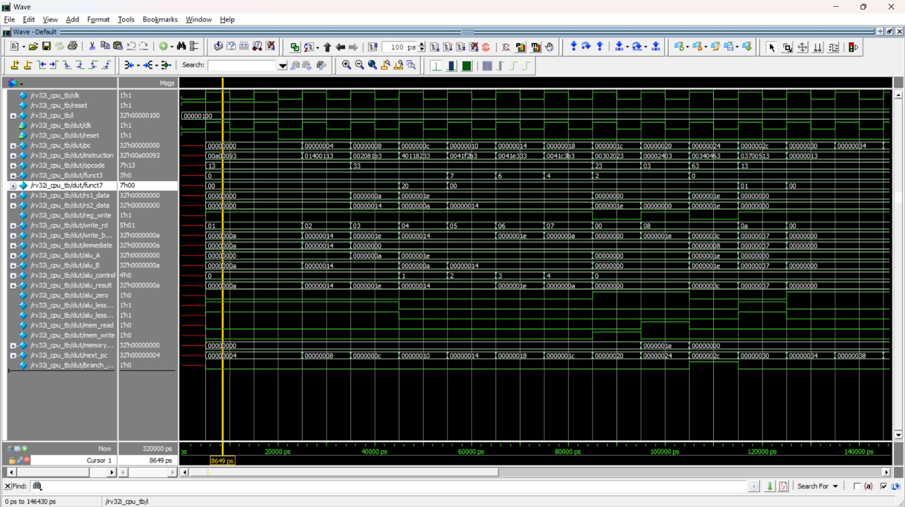
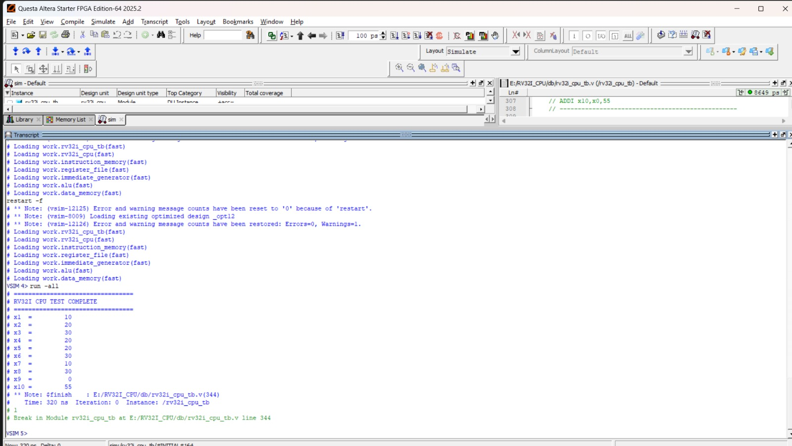

# RV32I-CPU
32-bit RISC-V CPU using Verilog HDL
# RV32I RISC-V Processor Design Using Verilog HDL

<p align="center">

**A Verilog-Based 32-Bit RISC-V CPU Implementation and Functional Verification**

</p>

## 📌 Project Overview

This project implements a **32-bit RISC-V RV32I processor** using Verilog HDL. The processor is designed based on the RISC-V base integer instruction set architecture (ISA).

The project focuses on understanding CPU architecture, instruction execution, datapath design, ALU operations, register management, memory access, and functional verification.

The design is developed using **Intel Quartus Prime Lite Edition** and verified through **Questa RTL Simulation** without requiring a physical FPGA board.

## 🎯 Project Objectives

- Design a 32-bit RV32I processor using Verilog HDL.
- Understand the internal architecture of a RISC-V CPU.
- Implement arithmetic and logical operations using an ALU.
- Develop instruction memory and data memory modules.
- Implement register file and immediate generation.
- Verify processor functionality using a Verilog testbench.
- Analyze CPU execution using RTL simulation waveforms.

## 🏗️ CPU Architecture

The processor consists of the following major components:

1. **Program Counter (PC):** Stores the address of the current instruction.
2. **Instruction Memory:** Stores instructions executed by the processor.
3. **Register File:** Contains 32 general-purpose 32-bit registers.
4. **Immediate Generator:** Generates immediate values from instructions.
5. **ALU:** Performs arithmetic and logical operations.
6. **Data Memory:** Handles load and store operations.
7. **Control Logic:** Controls instruction execution and datapath operations.

## ⚙️ Technologies Used

| Tool / Language | Purpose |
|---|---|
| Verilog HDL | Hardware description |
| Intel Quartus Prime Lite | RTL design and compilation |
| Questa | RTL simulation |
| GTKWave (optional) | Waveform visualization |
| Git & GitHub | Version control |

## 📂 Project Structure

```text
RV32I-CPU/
│
├── alu.v
├── data_memory.v
├── immediate_generator.v
├── instruction_memory.v
├── register_file.v
├── rv32i_cpu.v
│
├── rv32i_cpu_tb.v
│
├── rv32i_cpu.qpf
├── rv32i_cpu.qsf
│
├── cpu_waveform.png.jpeg
├── questa_transcript.txt.jpeg
│
└── README.md
```

## 🔧 Module Description

| File | Description |
|---|---|
| `alu.v` | Performs arithmetic and logical operations |
| `data_memory.v` | Stores and retrieves data |
| `immediate_generator.v` | Generates immediate instruction values |
| `instruction_memory.v` | Stores program instructions |
| `register_file.v` | Provides register read and write operations |
| `rv32i_cpu.v` | Top-level CPU implementation |
| `rv32i_cpu_tb.v` | Verifies CPU functionality using a testbench |

## 🧠 Instruction Execution

The processor follows the basic instruction execution sequence:

1. **Instruction Fetch:** Fetches the instruction using the Program Counter.
2. **Instruction Decode:** Decodes the opcode and identifies the operation.
3. **Execute:** Performs the required operation using the ALU.
4. **Memory Access:** Reads or writes data when required.
5. **Write Back:** Stores the result in the destination register.

## 🧪 Simulation and Verification

The processor is verified using a Verilog testbench in Questa RTL Simulation.

**Verification includes:**

- Clock generation.
- Reset operation.
- Instruction execution.
- ALU functionality.
- Register file operations.
- Program Counter progression.
- Simulation waveform analysis.

### CPU Waveform

The following waveform screenshot demonstrates the processor's RTL simulation and signal activity.



### Questa Simulation Transcript

The simulation transcript provides the execution log and verification output generated during testbench execution.



## 📊 Expected Simulation Analysis

The Program Counter advances through the instruction addresses during sequential execution.

Example PC progression:

```text
0000007C
00000080
00000084
00000088
0000008C
```

Each increment of 4 bytes represents the next sequential instruction address, assuming no branch or jump changes the execution flow.

## 🚀 How to Run the Project

**Step 1:** Clone the repository.

```bash
git clone https://github.com/YOUR_USERNAME/RV32I-CPU.git
```

**Step 2:** Open Intel Quartus Prime Lite.

**Step 3:** Open the project file:

```text
rv32i_cpu.qpf
```

**Step 4:** Compile the Verilog design.

**Step 5:** Open Questa and create an RTL simulation.

**Step 6:** Add the required CPU signals to the waveform window.

**Step 7:** Run the simulation and observe the processor operation.

## 🔬 Applications

- Computer architecture education.
- RISC-V processor research.
- Digital system design.
- Verilog-based CPU development.
- FPGA-based processor implementation.
- Processor architecture optimization research.

## 📈 Future Improvements

- Implement additional RV32I instructions.
- Improve branch and jump instruction handling.
- Develop a pipelined RV32I processor.
- Implement hazard detection and forwarding.
- Optimize CPU area and timing.
- Integrate instruction and data memory more efficiently.
- Explore FPGA hardware implementation.

## 👨‍💻 Author

**NITHISH S**

Electronics and Communication Engineering (ECE)

**Project Domain:** Digital VLSI Design | Computer Architecture | RISC-V

## 📜 License

This project is developed for educational and research purposes.

